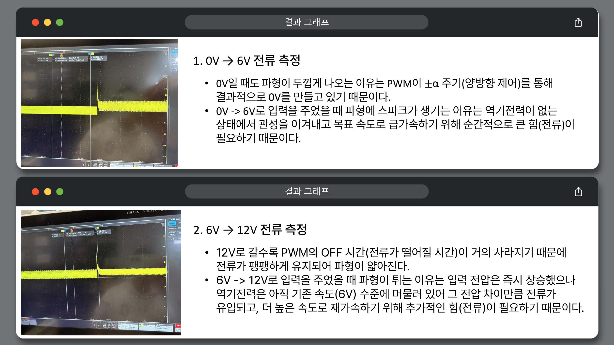
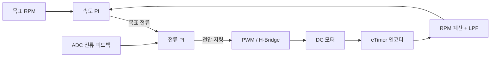

# MPC5604P Microcontroller Labs

**MPC5604P 보드에서 주변장치 레지스터를 설정하고, 센서 통신과 DC 모터의 전류·속도 제어를 실습한 기록입니다.**

윤종범 · 국민대학교 자동차IT융합학과 · 3학년 2학기 마이크로프로세서응용

`Embedded C` · `MPC5604P` · `CodeWarrior` · `FreeMASTER` · `SPI` · `ADC / PWM` · `PI Control`

## 무엇을 했나요?

| 실습 | 구현·관찰한 내용 | 코드 / 자료 |
|---|---|---|
| GPIO · ADC | 스위치 입력, ADC 읽기, 입력값 구간에 따른 LED 제어 | [`labs/adc-gpio/main.c`](labs/adc-gpio/main.c) |
| 타이머 · 인터럽트 | PIT 주기 인터럽트와 eTimer 입력 캡처·엔코더 카운트 | [`src/main.c`](src/main.c) |
| SPI 센서 통신 | Master / Slave 노드 간 초음파 거리 데이터 전송 과제 | [과제 기록](docs/SPI.md) |
| DC 모터 제어 | ADC 전류 피드백, H-Bridge PWM, 전류 PI 제어 | `ADCRead_0()` · `H_BridgeRun()` |
| 속도 피드백 | 엔코더 카운트 차이로 RPM 계산, 저역통과 필터, 속도 PI 제어 | `EncoderFdb()` · `SpeedCon()` |
| 디버깅 · 계측 | FreeMASTER 연동과 오실로스코프 전류 파형 관찰 | [제어 흐름](docs/MOTOR_CONTROL.md) |

수업에서 제공한 기본 프로젝트를 바탕으로 작성·수정한 코드입니다. SPI는 2인 과제였으며 팀 과제의 결과를 단독 성과로 소개하지 않습니다. 기반 예제와 공개 범위는 [출처](PROVENANCE.md)에 적었습니다.

## 실제 과제에 남긴 측정 결과



당시 제출한 DC 모터 과제의 결과 화면입니다. 기동 시 전류 변화와 PWM에 따른 파형을 관찰했습니다. 사진에서 정밀한 정착시간·오버슈트 수치를 새로 추정하지는 않았습니다.

## 제어 흐름



코드에는 적분항·출력 제한, 구동 enable 상태와 오류 입력에 따른 출력 제어가 포함돼 있습니다. 이 도식은 수업에서 다룬 신호 흐름이며, 튜닝 성능이나 제품 수준의 검증을 뜻하지 않습니다.

## 저장소 구성

```text
src/main.c                    # 모터·타이머·SPI 등을 포함한 수업 작업 스냅샷
labs/adc-gpio/main.c           # 앞 단계 GPIO·ADC 실습; 독립 main
patches/uart-19200.patch       # 기본 예제의 UART baud 설정 변경분
freemaster/Example.pmp         # 당시 FreeMASTER 프로젝트 설정
assets/                       # 제출 보고서에서 발췌한 결과·코드 설명 화면
docs/                         # 도구, 제어 흐름, SPI 과제와 확인 범위
```

## 실행 환경

CodeWarrior는 C 코드를 빌드하는 IDE이고, FreeMASTER는 보드 변수 관찰·조정을 위한 도구입니다. 다른 프로그램으로 작업했어도 C 소스는 GitHub에서 그대로 읽고 검토할 수 있습니다.

보드에서 다시 실행하려면 MPC5604P 기본 프로젝트의 장치 헤더·시작 코드·링커 설정과 해당 CodeWarrior 도구가 필요합니다. [`docs/ENVIRONMENT.md`](docs/ENVIRONMENT.md)에 복원 방법을 적었습니다. 두 `main.c`는 서로 다른 실습 단계이므로 동시에 링크하지 않습니다.

공개 정리에서는 기본 예제 압축본과의 변경 비교, 한글 인코딩 변환, 소스·자료의 연결을 확인했습니다. 전용 컴파일러로 다시 빌드하거나 보드를 연결해 재실행하지 않았으며, 원래 실습 코드의 동작을 고쳐서 제출한 것으로 표현하지 않았습니다.
