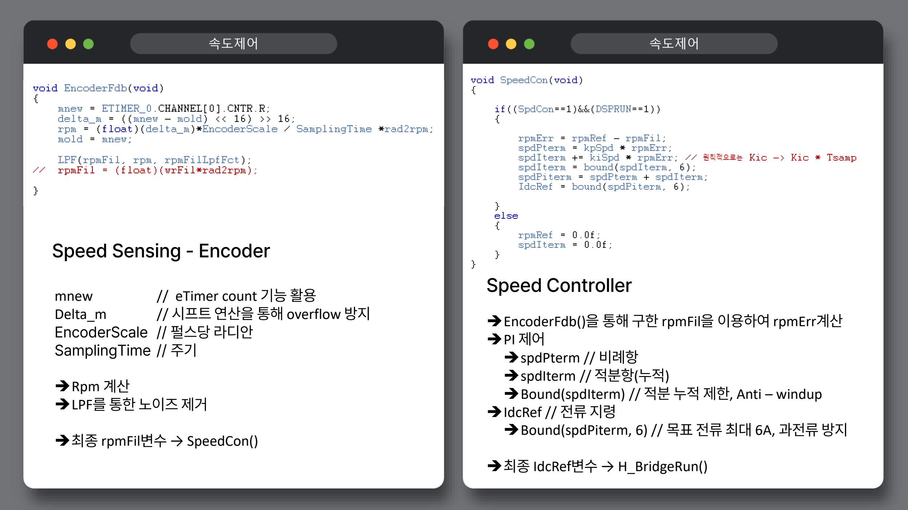
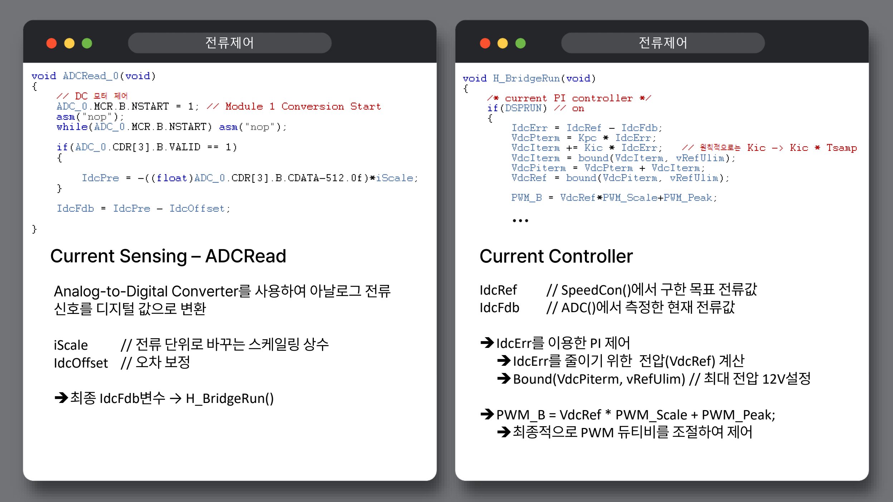

# DC 모터 제어 실습

## 피드백을 읽어 PWM까지 연결

`EncoderFdb()`는 eTimer 카운트의 이전값과 현재값 차이를 사용해 회전 속도를 계산하고 LPF를 적용합니다. `SpeedCon()`은 목표 RPM과 필터링한 RPM의 차이를 PI 제어에 넣고 전류 지령 `IdcRef`를 만듭니다. 코드에서 적분항과 최종 전류 지령은 ±6으로 제한합니다.

`ADCRead_0()`은 ADC로 읽은 값을 스케일링하고 offset을 반영해 전류 피드백 `IdcFdb`를 만듭니다. `H_BridgeRun()`은 `IdcRef - IdcFdb`를 바탕으로 전류 PI 출력을 계산합니다. 전압 지령은 ±12로 제한하고 `PWM_B = VdcRef * PWM_Scale + PWM_Peak`로 PWM register 값을 만듭니다.

제어기의 적분 계수는 샘플링 주기와 함께 해석해야 합니다. 실습 코드에도 `Ki * Tsamp` 관계가 주석으로 남아 있으며, 현재 코드의 숫자를 다른 모터·보드에 그대로 적용해도 된다는 뜻은 아닙니다.

## 당시 과제의 설명 자료

그림은 당시 제출 보고서의 설명이며, 공개 시점에 새로 수행한 실험 결과가 아닙니다. 적분항을 clamp하는 실습 방식을 보여주며 별도의 성능 수치나 완성된 튜닝 결과를 제시하지 않습니다.

## 계측에서 살펴본 점

0→6V, 6→12V로 입력을 변경했을 때 전류 파형이 바뀌는 모습을 오실로스코프로 관찰했습니다. 보고서에는 기동 과도 전류, PWM에 따른 ripple, 정지·부하 변화에 대한 해석도 남아 있습니다. 공개 저장소에는 확인 가능한 당시 화면을 보존하고, 원시 계측 데이터가 없는 수치 비교는 추가하지 않았습니다.
