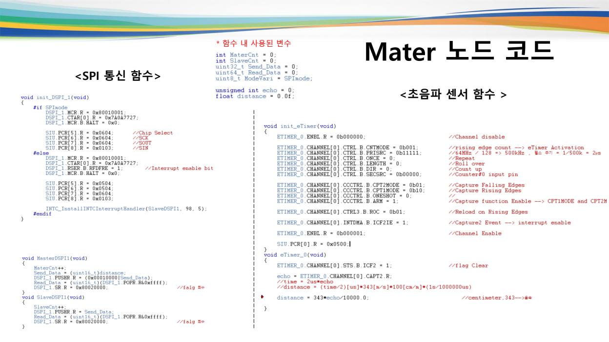

# SPI 초음파 센서 통신 과제

2인 과제로 Master / Slave 노드 사이에 초음파 센서의 거리 값을 전달했습니다. 보고서에는 PIT 주기 설정, DSPI pin·레지스터 설정, 전송·수신 함수, eTimer 입력 캡처 및 각 노드의 main 흐름이 남아 있습니다.

Master 설명 화면에서는 초음파 거리값을 `Send_Data`로 변환해 `DSPI_1.PUSHR`에 쓰고, 수신 데이터는 `DSPI_1.POPR`에서 읽습니다. eTimer 입력 캡처로 얻은 echo 시간을 거리로 바꾸는 과정을 함께 다뤘습니다.

공개한 통합 `src/main.c`에도 Master / Slave DSPI 함수가 있지만, 이후 모터 제어 실습이 더해진 시점의 파일입니다. 보고서의 SPI 과제를 재현하는 완성된 두 노드 firmware와 동일하다고 주장하지 않습니다. 저장된 팀 보고서만으로 개인별 구현 분담을 확정할 수 없어 개인 성과 수치도 붙이지 않았습니다.
